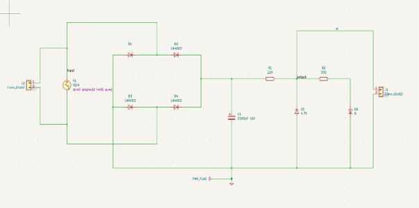
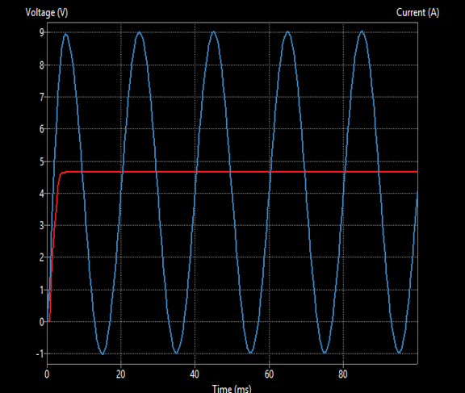

# AC-to-DC Linear Power Supply & Custom PCB

A custom single-layer PCB power supply designed, simulated, fabricated, and tested for **EE 101** at Boğaziçi University. It converts a $10\,\text{V}$ AC ($50\,\text{Hz}$) input into a stabilized DC output using a full-wave bridge rectifier, capacitive filter, and Zener regulator.


---

## 🛠️ Design & Simulation
- **Architecture:** Full-wave bridge rectifier ($4\times$ 1N4001) $\rightarrow$ $2200\,\mu\text{F}$ filter ($\approx 80\,\text{mV}$ ripple) $\rightarrow$ Zener shunt regulator ($R_1 = 220\,\Omega$) $\rightarrow$ Status LED ($R_2 = 330\,\Omega$).
- **Verification:** Designed in **KiCad** and verified via transient analysis in **LTspice** before fabrication.

| Circuit Schematic (KiCad) | Transient Simulation (LTspice) |
| :---: | :---: |
|  |  |

---

## 🏭 PCB Fabrication & Lab Results
The single-layer FR4 board was fabricated in-house using **Positiv 20** photoresist coating, UV exposure, $0.7\%$ $\text{NaOH}$ developing, $\text{HCl} + \text{H}_2\text{O}_2$ chemical etching, drilling, and through-hole soldering.

| Parameter | Target / Computed | Measured (Lab) |
| :--- | :---: | :---: |
| **Input Voltage ($V_{\text{in}}$)** | $10\,\text{V}$ AC | $10.08\,\text{V}_{\text{rms}}$ |
| **Regulated Output ($V_{\text{out}}$)** | $4.70\,\text{V}$ DC | **$5.157\,\text{V}$ DC** |

> **Error Analysis:** The $0.457\,\text{V}$ deviation was traced to procuring a $5.0\,\text{V}$ Zener diode instead of $4.7\,\text{V}$. Relative to $5.0\,\text{V}$, the remaining $0.157\,\text{V}$ ($\approx 3.1\%$) error is within standard Zener manufacturing tolerance ($\pm 5\%$).

| Fabricated PCB | Lab Test Setup |
| :---: | :---: |
|  |  |

## 📂 Repository Structure

```text
├── docs/
│   └── EE101_Project_Report.pdf    # Full technical report
├── kicad/
│   ├── schematic.kicad_sch         # KiCad schematic file
│   └── layout.kicad_pcb            # KiCad PCB layout file
├── images/
│   ├── schematic.png
│   ├── pcb_layout.png
│   ├── ltspice_sim.png
│   ├── pcb_final.jpg
│   └── lab_test.jpg
└── README.md
